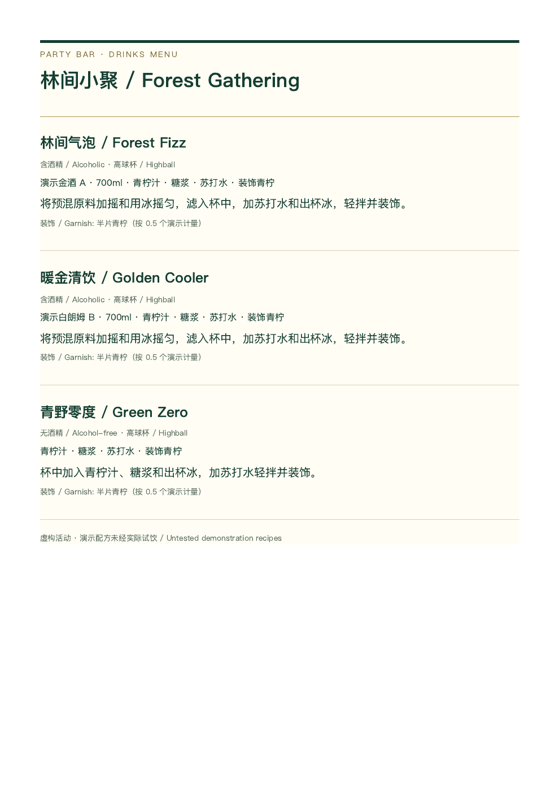

# party-bar-planner

A local Agent Skill that turns cocktail recipes and a party plan into per-drink recipes, shopping lists, cost estimates, and a practical prep and service guide.

**给出鸡尾酒配方、聚会人数与饮用计划，生成完整单杯配方、总材料清单、准备工作、当晚出酒流程，以及成本估算和可打印酒单。**

本地 Python 工具 + 可独立携带的 Agent Skill，MIT 开源。核心仅用 Python 标准库，无账号、数据库、网络请求、付费 API 或在线购买。示例活动、配方与价格均为虚构，**演示配方未经实际试饮**。

## 安装与运行

需要 Python 3.10+，核心功能无需安装依赖：

```sh
git clone https://github.com/ChrisssTsui/party-bar-planner.git
cd party-bar-planner
```

在项目根目录运行：

```sh
python3 tools/run_demo.py
```

一条命令生成 4、6、10 人三组完整示例到 `examples/output-4`、`output-6`、`output-10`。命令不修改输入；会覆盖输出目录中的固定同名生成文件。

使用自己的数据：

```sh
python3 party-bar-planner/scripts/planner.py examples/party-6.json --out output/my-party
python3 -m unittest discover -s tests -v
```

Agent 使用说明见 [SKILL.md](party-bar-planner/SKILL.md)；可把整个 `party-bar-planner/` skill 子目录作为独立资源分发，计算不依赖仓库其他文件。本项目不自动安装到任何 agent。

## 输入 → 输出示例

[6 人输入](examples/party-6.json) 包含 3 款饮品：两款含酒精、一款无酒精，12 杯按 1:1:1 分成各 4 杯，另有部分金酒、青柠汁和糖浆库存。它没有假设每人喝所有款。

| 计划 | 总杯数 | 林间气泡 | 暖金清饮 | 青野零度 |
|---|---:|---:|---:|---:|
| [4 人](examples/party-4.json) | 8 | 3 | 3 | 2 |
| [6 人](examples/party-6.json) | 12 | 4 | 4 | 4 |
| [10 人](examples/party-10.json) | 20 | 7 | 7 | 6 |

本例人为选择每人平均两杯作为演示计划；工具不会将这个假设用于用户输入。支持 `per_guest` 明确指定每人各款杯数，或 `total_ratio` 明确指定总杯数和权重。最大余数法确定性分杯，同余数按 ID 字典序。

每组首先交付 [备料与出酒操作手册 bar-guide.md](examples/output-6/bar-guide.md)：按“完整单杯配方 → 总共需要的材料 → 提前准备 → 当晚逐杯出酒”组织，含精确用量、杯型、装饰、预混批量与每杯取用方式。

每组输出：

| 文件 | 内容 |
|---|---|
| [bar-guide.md](examples/output-6/bar-guide.md) | 用户主交付：完整单杯配方、总材料、准备工作及逐款当晚出酒流程 |
| [shopping.md](examples/output-6/shopping.md) / [shopping.csv](examples/output-6/shopping.csv) | 合并原料、基础/余量/损耗、库存、整包数、两种剩余口径、成本摘要与待确认项 |
| [costs.csv](examples/output-6/costs.csv) | 包装价格、基础耗用成本、整包采购支出；未知值留空 |
| [batches.md](examples/output-6/batches.md) | 各款杯数、单杯/批量用量、用冰分类与准备步骤 |
| [menu.html](examples/output-6/menu.html) | 深绿、米白、暖金，中英名称，中文字体回退，A4 打印样式，无内部成本 |
| [summary.json](examples/output-6/summary.json) | 人数、各款杯数、总杯数与警告，便于程序读取 |

[独立手算](examples/HAND-CHECK.md) 核对 6 人基础耗用成本 **156.80 HKD**、整包采购支出 **381.00 HKD**。安全余量和装饰损耗单列，未加进每杯配方。CSV 使用 UTF-8 BOM，Excel 可读；用户文本以公式符号起始时加单引号防止公式执行。单位归一化到 ml/g/个，无密度转换。

详细字段、库存、价格与计算口径见 [输入格式](party-bar-planner/references/input-format.md)。缺少饮用计划会报错并要求确认；未知冰量会明确排除于采购估算并提示确认；未知价格只列已知小计，拒绝混币种。



## 打印与可选导出

直接浏览器打开 HTML，选择 A4、100% 缩放；使用项目 CSS 的 15mm 页边距，关闭浏览器页眉页脚，开启背景图形。示例已通过本机 Chrome 渲染和目视检查，附有 [PDF](examples/output-6/menu.pdf) 与 [打印预览 PNG](examples/output-6/menu-print.png)。

可选自动导出需要 Node.js、Playwright 和本机 Chrome（不影响标准库计算 CLI）：

```sh
npm install --no-save --package-lock=false playwright
node tools/render_menu.cjs examples/output-6/menu.html "/Applications/Google Chrome.app/Contents/MacOS/Google Chrome"
# Linux 可用 /usr/bin/google-chrome；传入本机实际路径。
```

导出器仅允许本地 file: 请求，生成 PDF、屏幕 PNG 和布局检查 JSON；不下载浏览器、不调用 API。若装有 Poppler：

```sh
pdftoppm -scale-to 1400 -png -singlefile examples/output-6/menu.pdf examples/output-6/menu-print
```

完整验证记录见 [VALIDATION.md](VALIDATION.md)。CLI 只生成 HTML 等核心文件；重新生成输入后需要另行重导 PDF，避免使用旧预览。

## 边界与后续

- 每种原料当前只有一种包装和单价；不做多包装组合优化、真实酒精度判断或密度换算。无酒精标记由输入声明，需核对所用原料。
- 汽水/冰/鲜切装饰需正确标记 `serving_only`；装饰说明文字不自动计量。预混标记须人工核对，不承诺保存期。
- 示例 3 款的 A4 渲染已验证；更长的名称/做法或更多款可能跨页，需要重新检查打印。系统字体差异也可能改变分页。

后续可优先增加：严格拒绝未知字段的 JSON Schema 校验；多种包装的可解释优化；跨平台打印回归样例。
